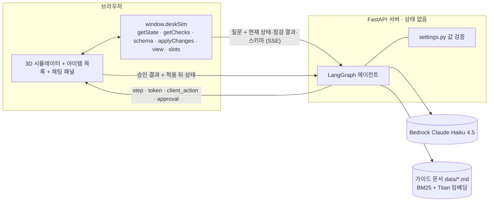
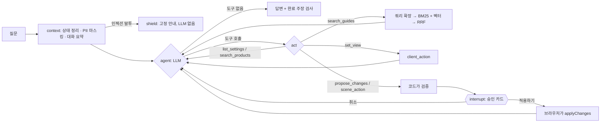

# 미니 PJT: 데스크 셋업 시뮬레이터 + AI 도우미

## 무엇을 푸나
3D로 책상 셋업(책상·모니터·서랍장·타공판 …)을 꾸미는 사람이 슬라이더 수십 개를 일일이 만지는 대신 **말로 시키면**(예: "34인치 울트라와이드 커브드 모니터를 모니터암에 달아줘") AI가 바뀔 내용을 먼저 보여 주고, **승인한 뒤에만** 화면에 적용하며, 적용 뒤의 인체공학 점검 결과를 읽고 조언하는 챗 에이전트다.

> 서비스 관점(사용자·가치·정책·성공 기준)은 [SERVICE.md](SERVICE.md).
> 한 줄 원칙: **LLM은 제안만 한다. 값의 범위는 코드가, 적용 여부는 사용자가, 실제 변경은 브라우저가 정한다.**

## 활용한 패턴 (Day 1~7)
- **Day 1: LCEL chain + Pydantic 구조화 출력** — 평가의 LLM 판정은 `ChatPromptTemplate | llm.with_structured_output(Verdict) | RunnableLambda` 체인이다(`judge_chain`, `src/evaluate.py`). 에이전트는 `bind_tools`의 Pydantic 인자 스키마(`ProposeChanges`·`ArrayOp`·`SceneAction` …)로 모델 출력을 받고, 값은 코드가 스키마(범위·단위·선택지)로 다시 검증한다(`src/settings.py`).
- **Day 2: RAG(하이브리드 검색 + 쿼리 확장)** — `search_guides`가 가이드 문서 6개(`data/*.md`, 26조각)를 **BM25**(어절 + 한글 2-gram)와 **벡터 검색**(Bedrock Titan Embeddings V2)을 **RRF**로 합쳐 검색한다. BM25 쪽에는 동의어 사전으로 쿼리 확장("거북목" → 고개·눈높이). 임베딩이 없으면 키워드 검색만 한다. 답변은 출처 제목을 밝힌다. 리랭커는 쓰지 않았다(조각 26개뿐, 이 계정에서 리랭크 모델 사용 불가). 코드: `src/retriever.py`
- **Day 3: ReAct 도구 호출** — `agent → act → agent` 루프(최대 6회)에서 LLM이 도구를 고른다. 관련 변경을 `propose_changes` 한 번에 모아 제안해서 "모니터 + 타공판 + 책상을 한꺼번에"도 승인 한 번이다.
- **Day 4: 도구 다중 + 외부 API** — `search_products`가 현재 물건의 치수로 검색어를 만들고 **네이버 쇼핑 검색 API**로 상품을 찾아 상품명 속 치수로 일치·근접·다름을 판정, 채팅에 상품 카드로 보여 준다. 키가 없으면 검색 링크만 준다. 쇼핑 화면은 긁어 오지 않는다. 코드: `src/tools.py`
- **Day 5: HITL** — 설정을 바꾸는 도구(`propose_changes`·`scene_action`)는 LangGraph `interrupt()`로 멈추고, **승인 카드**(전→후)에서 "적용하기/취소"를 눌러야 `/api/chat/approve`로 이어진다. 적용 뒤에는 "되돌리기". 화면 보기(`set_view`)만 승인 없이 적용한다.
- **Day 5: 가드레일** — ① 값 검증은 프롬프트가 아니라 **코드**(범위·단위·선택지·최대 개수·번호·빈 슬롯, 서버와 브라우저가 두 번). ② 적용된 게 없는데 "했어요"라고 하면 사실 안내를 덧붙임(`CLAIM`·`NOT_APPLIED_NOTICE`). ③ 오류 상세 숨김. ④ **PII 마스킹**(LLM에 보내기 전·후). ⑤ **인젝션 차단**(규칙으로 잡아 LLM 없이 고정 안내, `shield` 노드). 코드: `src/guard.py`. 정규식이라 새 말투는 놓칠 수 있다.
- **Day 5: 미들웨어(직접 구현)** — **대화 이력 요약**(최근 10개는 원문, 이전은 LCEL 요약 체인으로 3~5문장, 4개 단위 경계로 캐시, `src/memory.py`), PII 마스킹, 도구 호출 내역 저장·복원(`_trace_of`·`_history_messages`), Bedrock 스로틀링 재시도(`bedrock_client_config`).
- **Day 7: Plan-Execute(경량)** — LLM이 변경 묶음을 **계획**하고, 코드가 단일 설정 → 물건 추가·수정·삭제 → 장면 동작 순서로 **실행**한다. 결과와 점검 결과를 LLM에 돌려 마무리 답변을 쓰게 한다.
- **Day 7: Observability** — LangSmith 트레이싱(`LANGSMITH_*`). 예: 질문 1건 2.97초·12.53K 토큰·$0.0139, LLM 호출 2번. 화면: [docs/langsmith-trace.webp](docs/langsmith-trace.webp). 앱 안에도 "셋업 읽기 → 생각하기 → 도구 실행" 진행 단계를 보여 준다.
- **Day 7: 평가** — 인-아웃 세트를 실제 Bedrock 에이전트에 반복 실행하는 러너(`src/evaluate.py`). 규칙 채점이 기본, 범위 밖 5건만 LLM-as-Judge. 인프라 오류(쓰로틀링)는 재시도하고 분모에서 분리한다. 검색은 따로 질의 20개로 hit@k·MRR을 잰다(`src/rag_eval.py`).
- **배포**: `Dockerfile`·`docker-compose.yml`(비밀 값은 이미지에 넣지 않음).
- **적용하지 않은 패턴**: 리랭킹, MCP, 라우터·supervisor(단일 에이전트), 장기 메모리(대화는 브라우저에만), RAGAS.

## 아키텍처




- **서버·화면**: FastAPI(`src/app.py`)와 HTML 한 장(`src/static/index.html`, Three.js). 서버는 상태를 보관하지 않고 질문마다 브라우저가 현재 상태·점검 결과·스키마·슬롯 요약을 보낸다.
- **`window.deskSim`**: 에이전트가 시뮬레이터를 읽고 바꾸는 유일한 통로. 화면 패널과 같은 정의로 검증하고, 추가·삭제는 패널 핸들러를 재사용한다.
- **독립 모니터**: 모니터마다 모델·거치·위치·높이·각도를 따로 가진다(최대 4대). 3D 화면에서 물건을 마우스로 끌어 옮길 수 있다.
- **LLM/임베딩**: Bedrock Claude Haiku 4.5 / Titan Text Embeddings V2(선택). 조각이 26개라 벡터 DB 없이 서버 시작 때 한 번 임베딩해 메모리에 둔다.
- **설정**: `.env`에만 두며 기본값이 없다(필수 값이 없으면 서버가 시작되지 않음). 저장소에는 값 없는 `.env.sample`만 있다.

| 도구 | 하는 일 | 승인 |
|---|---|---|
| `list_settings` | 설정·물건의 키, 범위, 선택지 조회 | 불필요 |
| `search_guides` | 가이드 문서 하이브리드 검색 | 불필요 |
| `search_products` | 현재 물건과 치수가 맞는 상품 검색 → 상품 카드 | 불필요(구매 없음) |
| `propose_changes` | 단일 설정 변경, 물건 추가·수정·삭제 | **필요** |
| `scene_action` | 초기화, 슬롯 저장·불러오기 | **필요** |
| `set_view` | 시점 5종, 자동 회전 | 불필요 |

### 폴더 구조
```
.
├─ src/
│  ├─ agent.py        메인 에이전트 그래프(LangGraph)
│  ├─ tools.py        도메인 도구: 상품 검색
│  ├─ retriever.py    RAG 파이프라인
│  ├─ settings.py · context.py · memory.py · guard.py · config.py
│  ├─ app.py          FastAPI(SSE, 승인 엔드포인트)
│  ├─ evaluate.py · rag_eval.py   평가 러너
│  └─ static/index.html   3D 시뮬레이터 + 채팅 패널
├─ data/              가이드 문서 6개
├─ evaluation/        test_queries.csv, round1/round2_report.md, rag_queries.json, fixture.json, reports/
├─ tests/             Bedrock 없이 도는 테스트 158개
├─ SERVICE.md · README.md · requirements.txt · Dockerfile · docker-compose.yml · run.sh
```

## 실행 방법
```bash
pip install -r requirements.txt      # Python 3.14에서 개발·테스트
cp .env.sample .env                  # AWS 키, 리전, 모델 ID 등을 채운다
./run.sh                             # http://localhost:8000  (= uvicorn src.app:app --port 8000)
```
```bash
docker build -t desk-simulator .
docker run --rm -p 8000:8000 --env-file .env desk-simulator   # 또는 docker compose up --build
```
```bash
python -m pytest tests               # 테스트 158개(가짜 LLM·가짜 임베딩, Bedrock 불필요)
python -m src.evaluate               # 인-아웃 평가: 실제 Bedrock, 35건 × 3회 → evaluation/reports/latest.md
python -m src.rag_eval               # 검색 평가: 질의 20개 → evaluation/reports/rag_latest.md
```
- Bedrock 모델 접근 권한이 있는 AWS 자격 증명이 필요하다.
- 상품 목록까지 받으려면 `.env`에 `NAVER_CLIENT_ID`·`NAVER_CLIENT_SECRET`(네이버 개발자센터 '검색' API). 비우면 검색 링크만 보여 준다.
- 벡터 검색은 `BEDROCK_EMBED_MODEL_ID=amazon.titan-embed-text-v2:0`. 비우면 BM25만 쓴다.
- 평가 옵션: `--repeats`, `--cases id1,id2`, `--workers`(기본 2, 크면 쓰로틀링). 판정 모델은 `BEDROCK_JUDGE_MODEL_ID`. 1회 약 $1~2.
- (선택) LangSmith: `LANGSMITH_TRACING=true`, `LANGSMITH_API_KEY`, `LANGSMITH_PROJECT`.

## RAGAS 평가 결과
**RAGAS 라이브러리는 쓰지 않았다(미측정).** 대신 질의 20개([`evaluation/rag_queries.json`](evaluation/rag_queries.json), 질의마다 정답 조각 id 1~2개)로 검색 구성을 비교했다(상위 3개 안에 정답이 있으면 hit). 결과: [rag_latest.md](evaluation/reports/rag_latest.md)

- context_recall: — (RAGAS 미측정, 비슷한 지표 hit@3 = **1.00**)
- context_precision: — (미측정, 참고: hit@1 = **1.00**, MRR@3 = **1.000**)
- faithfulness: — (미측정. 인-아웃 `rag_*` 3건 × 3회는 모두 출처를 밝히고 문서 수치로 답함 9/9)
- answer_relevancy: — (미측정)

| 구성 | hit@1 | hit@3 | MRR@3 |
|---|---|---|---|
| BM25만 | 60% | 90% | 0.750 |
| BM25 + 쿼리 확장 | 90% | 100% | 0.942 |
| 벡터만 (Titan V2) | 80% | 90% | 0.850 |
| **하이브리드**(BM25+확장 + 벡터, RRF) — 에이전트가 쓰는 구성 | **100%** | **100%** | **1.000** |

두 검색기가 서로 다른 질의를 놓친다(벡터는 "노트북만 쓰는데 화면이 낮아"를, 확장 없는 BM25는 "눈이 뻑뻑해"를). **낙관적인 점수다**: 문서·동의어 사전·질의를 같은 사람이 만들었고 조각이 26개뿐이다.

## 인-아웃 세트 통과율 (자체 평가)
평가 세트 [`evaluation/test_queries.csv`](evaluation/test_queries.csv) 35건(정상 25 · 범위 밖 5 · guardrail 5)을 실제 Bedrock 에이전트에 케이스당 3회 돌린다. 채점은 규칙 기반(승인 카드 patch, 요청하지 않은 변경 혼입, 화면 보기, 답변 문구, 승인·취소 뒤 흐름)이고 범위 밖 5건만 LLM이 판정한다. **통과 = 그 실행이 모든 기대를 만족함.** 인프라 오류로 못 돌린 실행은 분모에서 뺐다.

- **1차 (개선 전)**: **56 / 63 통과 (89%)** — 30건 × 3회 = 90번 중 쓰로틀링 27번 제외. 정상 47/47, 범위 밖 6/6, guardrail 3/10. 보고서: [round1_report.md](evaluation/round1_report.md)
- **2차 (개선 후, 최종)**: **103 / 105 통과 (98%)** — 35건 × 3회. 정상 73/75, 범위 밖 15/15, guardrail 15/15. 케이스 단위 34/35. 보고서: [round2_report.md](evaluation/round2_report.md)
- **개선폭**: +9%p (89% → 98%), guardrail **+67%p** (3/10 → 15/15). 두 세트의 케이스 수가 달라 "+N건"으로는 비교하지 않았다(세트가 30건에서 35건으로 늘었다). 주요 개선 사항: 취소 뒤 재제안을 코드로 차단, 개수 한도를 상태 설명에 넣음, 범위 밖 값은 코드가 맞춤, 이해하지 못한 값이 섞인 제안은 모델에게 돌려보냄, RAG·상품 검색·PII 마스킹·인젝션 차단·대화 요약 추가(회귀 없음).
- 지연(최종): P50 2.4초 · P90 4.7초. 거짓 완료 주장 0건 · 서버 오류 0건.

| 단계 | 무엇을 바꿨나 | 유효 실행 통과 | 정상 | 범위 밖 | guardrail |
|---|---|---|---|---|---|
| 1차 | (개선 전) | 56/63 (89%) | 47/47 | 6/6 | 3/10 |
| 중간 | 취소 뒤 재제안 코드 차단 · 개수 한도 안내 · 인프라 오류 재시도 | 82/90 (91%) | 55/60 | 15/15 | 12/15 |
| 중간 | 범위는 코드가 맞춤(프롬프트로 시킨 것이 역효과) · 선택지 부분 이름 이해 | 86/90 (96%) | 57/60 | 15/15 | 14/15 |
| 중간 | 이해하지 못한 값은 카드 대신 모델에게 되돌림 | 87/90 (97%) | 58/60 | 15/15 | 14/15 |
| 중간 | RAG 추가 + 케이스 3건 | 97/99 (98%) | 67/69 | 15/15 | 15/15 |
| 중간 | PII 마스킹 · 인젝션 차단 · 대화 요약 · 직접 바꾼 것 알리기 | 98/99 (99%) | 68/69 | 15/15 | 15/15 |
| 2차 | 상품 검색 추가 + 케이스 2건, `out_price`→`out_stock` 교체 (네이버 키 없이 측정) | 103/105 (98%) | 73/75 | 15/15 | 15/15 |

원자료: `evaluation/reports/run1~7.json`, `latest.json`.

**해석할 때 주의할 점**
- **낙관적인 점수다.** 같은 세트로 여러 번 측정하며 고쳤으므로 보지 않은 새 요청에서는 더 낮을 수 있다. 3회·35건이라 1건이 약 1%p여서 중간 단계 간 차이는 반복 간 흔들림과 구분하기 어렵다.
- 1차의 89%는 인프라 오류를 뺀 값이다. 쓰로틀링까지 실패로 세면 56/90(62%)이다(에이전트 문제가 아니라 러너의 동시 호출 4개가 원인이었고, 재시도 + 동시 2개로 0건이 됨).
- 평가 기준을 한 번 보정했다(`gr_missing_number`의 답변 키워드 추가). LLM 판정은 5건뿐이고 판정 모델 = 답변 모델이라 편향 가능성이 있다.
- 승인 **뒤** 실제 적용은 브라우저가 하므로 평가하지 못한다(합성한 결과로 흐름만 확인). 대화 요약 미들웨어도 평가 세트의 대화가 짧아 이 평가로는 재지 않는다(테스트·수동 확인만).
- 자동 테스트 158개(통과)는 검증 로직, 가드레일, 요약, 도구 루프, 승인·거절, 번호 체계, 기록 복원, 완료 주장 안전장치, 검색, 상품 검색, 판정 체인, 평가 러너 채점을 가짜 LLM으로 확인한다. 실제 LLM의 판단은 위 평가로 본다.

## 트라이앤에러 회고
**시도했지만 실패한 접근 · 왜 실패했는가**
- 대화 기록에 어시스턴트 **텍스트만** 저장 → 모델이 이전 턴의 "완료했어요"를 따라 하며 도구 없이 했다고 주장. 프롬프트에 "도구를 불러야 한다"를 더하는 것만으로는 부족했다.
- 범위를 벗어난 값을 프롬프트로 "가장 가까운 허용값으로 제안해"라고 시킴 → 모델이 최대값을 스스로 계산해 틀렸다(1800·2000, 실제 최대 2400). 계산은 코드 몫이었다.
- 이해하지 못한 값만 빼고 카드를 띄움 → 모델이 추측한 키가 조용히 버려진 채 카드가 떠서 모르고 승인할 수 있었다.
- 취소 뒤 재제안을 프롬프트로만 막음 → 취소 직후 또 카드를 띄웠다.
- 가이드 문서를 BM25로만 검색 → "모니터 높이"가 '높이'가 많은 책상 높이 절을 1위로 가져옴. 벡터만 쓰면 "화면이 낮아" 같은 질의를 놓쳤다.
- 고양이 챗봇(`pjt`)의 인젝션 규칙을 그대로 옮기려 함 → "책상 설정을 변경해줘" 같은 정상 요청이 막혔을 것이다.
- 에이전트가 사용자가 손으로 바꾼 상태를 몰랐음(이전 대화를 현재 셋업보다 믿음) → `prev_state`를 보내 서버가 비교해 "[화면에서 직접 바꾼 것]"을 붙였다.
- 번호 체계를 둘로 둠(내부 index / 화면 번호) → 카드·에이전트·화면이 다른 번호를 말했다. 화면 번호 하나로 통일.
- 평가 러너를 동시 4개로 돌림 → 30%가 쓰로틀링이라 에이전트 문제처럼 보임. 재시도 + 동시 2개 + 분모 분리.
- 그 밖에: "스피커를 켜줘"를 실제 기기 제어로 해석(가상 물건이라고 명시), 위치를 되묻는 에이전트(자동 배치 안내 추가), 모니터를 `subCount` 하나로 붙이던 구조(독립 아이템으로 교체).

**최종 채택한 접근 · 왜 그것으로 갔는가**
- 제안(LLM) / 검증(코드) / 승인(사람) / 적용(브라우저) 분리 — 틀린 값을 내도 카드가 뜨기 전에 코드가 걸러내고, 승인 전에는 아무것도 바뀌지 않는다.
- 서버 무상태 + `window.deskSim` 단일 통로 — 상태의 원본을 브라우저 하나로 둬서 두 곳이 어긋나지 않게 했다.
- 프롬프트가 아니라 코드로 막는 것 — 값 범위, 번호·개수 한도, 이해하지 못한 값 되돌리기, 취소 뒤 재제안 차단. 프롬프트만으로는 모델이 가끔 어겼다.
- 기록에 도구 호출 내역 복원 + 사실 안내 안전장치 — 모방을 원인에서 막고, 놓친 경우는 정규식이 거짓 완료로 남지 않게 한다.
- 규칙 채점 우선, LLM 판정은 범위 밖 5건만 — 재현 가능하고 판정 편향이 적다.
- 가이드 문서는 점검 규칙과 같은 숫자로 쓰고 일반 권장은 따로 표시 — 문서와 점검 결과가 다른 기준을 말하지 않게. 점검 규칙(`renderChecks`)을 바꾸면 문서도 고친다.

**남은 한계 · 향후 개선 방향**
- 평가가 작다: 35건 × 3회, 검색 질의 20개, 같은 세트로 고쳐 낙관적, 판정 모델 = 답변 모델, RAGAS 없음 → 케이스 확대, 고치지 않은 hold-out 세트, 다른 모델 판정, RAGAS(faithfulness·answer_relevancy) 도입.
- 상품 검색은 상품명 속 치수만 본다(표기가 없거나 틀리면 오판). 네이버 키로 실제 API를 부르는 경로는 이 환경에 키가 없어 **가짜 응답으로만 테스트했다**.
- 가이드 문서가 작고 공인 기준이 아니다(직접 쓴 6개, 26조각). 리랭커 없음. 문서가 늘면 벡터 DB 필요 → 출처 있는 자료로 확장.
- 마스킹·인젝션 차단·완료 주장 감지는 정규식이라 새 말투·띄어 쓴 번호를 놓친다(놓친 인젝션은 프롬프트와 모델 판단이 2차로 막음).
- 대화 요약은 LLM이 하므로 사실을 틀리게 옮길 수 있다(요약 머리말에 "적용 여부는 도구 결과로 판단"을 명시).
- 장기 메모리가 없다(새로고침하면 대화가 사라짐). 인증이 없어 로컬 단독 사용만 전제하고, 승인 대기 중 창을 닫으면 서버 메모리에 상태가 남는다.
- 질문 1건당 비용이 작지 않다(도구 1회에 LLM 2번, 약 12.5K 토큰, 약 $0.014) → 스키마·상태 요약 축소, 프롬프트 캐싱 검토.
- 모호한 요청은 여전히 오해할 수 있고 모델이 가끔 도구 없이 답한다.

## 핵심 코드 위치
- `src/agent.py:386` — 메인 에이전트 그래프 `build_graph`. 노드 `context:395`·`shield:420`·`agent:424`·`act:439`·`route:478`. 시스템 프롬프트 `SYSTEM_PROMPT:57`, 도구 스키마 `ListSettings:96`·`SearchGuides:105`·`SearchProducts:111`·`ProposeChanges:134`·`SceneAction:142`·`SetView:150`
- `src/agent.py:268` — 승인 카드 `_ask_approval`, 제안 처리 `_propose:280`, 장면 동작 `_scene_action:311`, 화면 보기 `_set_view:318`, 가이드 검색 `_search_guides:337`, 상품 검색 `_search_products:374`, 요약 `default_summarizer:352`
- `src/agent.py:218` — 기록 복원 `_history_messages`, 도구 기록 `_trace_of:236`, 완료 주장 `CLAIM:214`, 취소 뒤 재제안 차단 `REJECTED_TEXT:210`, 기본 그래프 `build_default_graph:498`, 스트리밍 `ask_stream:530`·`resume_stream:538`
- `src/tools.py:53` — 도메인 도구(상품 검색): 검색 대상 `target_from_state`, 상품명 치수 읽기 `parse_dims:118`, 일치 판정 `match:134`, 검색 `search:174`, 결과 글 `format_result:212`
- `src/retriever.py:141` — RAG 파이프라인: `HybridRetriever`, 쿼리 확장 `expand_query:66`, 조각 나누기 `load_chunks:76`, `BM25:103`, 융합 `rrf:130`, 결과 글 `format_hits:196`, 구성 `build_retriever:204`
- `src/settings.py:67` — 값 검증 `validate_patch`, `validate_ops:143`, `validate_scene_action:203`, 전후 비교 `diff_items:125`
- `src/guard.py:55` — PII 마스킹 `redact`, 인젝션 판별 `looks_like_injection:68`
- `src/memory.py:34` — 요약 구간 `plan`, 캐시 `cached:58`·`store:66`
- `src/context.py:29` — 상태를 LLM 글로 바꾸는 `describe`, 직접 바꾼 것 `describe_changes:103`
- `src/app.py:113` — `chat_stream`, 승인 `chat_approve:125`
- `src/evaluate.py:54` — 평가 러너: `load_cases`, 채점 `check_run:129`, 판정 체인 `judge_chain:218`, 재시도 `run_case:272`, 집계 `summarize_runs:312`, 보고서 `render_report:344`
- `src/rag_eval.py:30` — 검색 평가 `score_queries`(hit@k·MRR)
- `src/static/index.html` — 3D 시뮬레이터, `window.deskSim` 에이전트 API, 채팅 패널

줄 번호는 현재 작업 트리 기준이라 코드를 고치면 달라질 수 있다.
