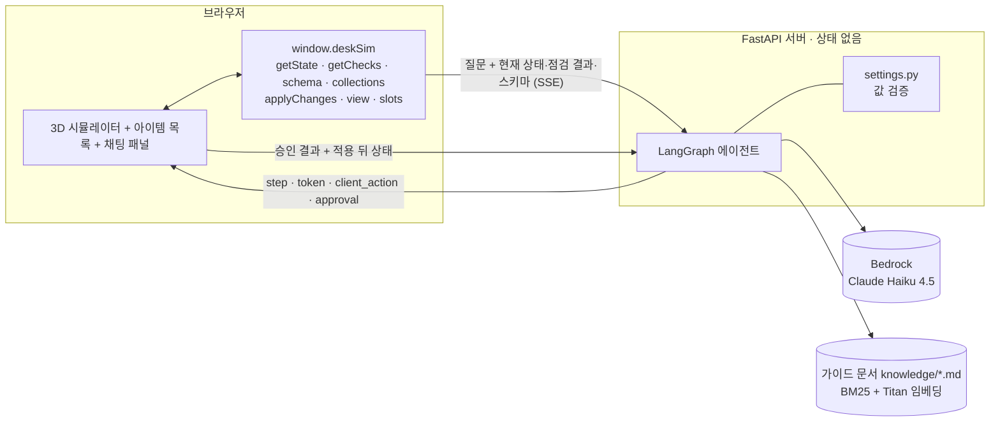
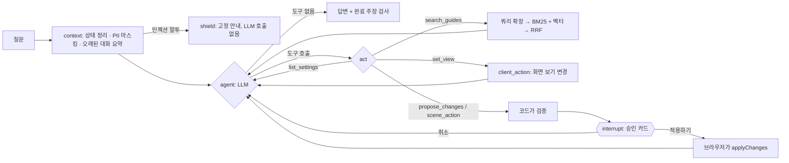
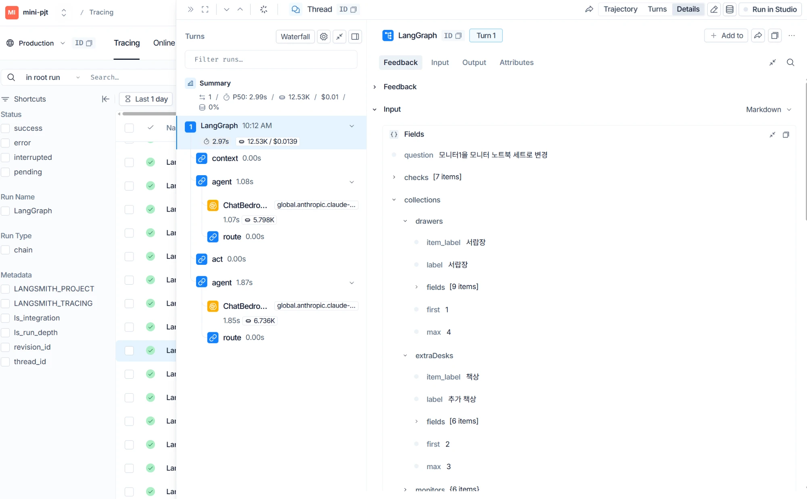

# 미니 PJT: 데스크 셋업 시뮬레이터 + AI 도우미

## 무엇을 푸나
3D로 책상 셋업(책상·모니터·서랍장·타공판 …)을 꾸미는 사람이 슬라이더 수십 개를 일일이 만지는 대신 **말로 시키면**(예: "34인치 울트라와이드 커브드 모니터를 모니터암에 달아줘") AI가 바뀔 내용을 먼저 보여 주고, **승인한 뒤에만** 화면에 적용하며, 적용 뒤의 인체공학 점검 결과(눈-화면 거리, 눈높이, 좌우 여유 …)를 읽고 조언하는 챗 에이전트다.

> 서비스 관점(사용자·가치·정책·성공 기준)은 [SERVICE.md](SERVICE.md)에 있다.

> 한 줄 원칙: **LLM은 제안만 한다. 값의 범위는 코드가, 적용 여부는 사용자가, 실제 변경은 브라우저가 정한다.**

## 활용한 패턴 (Day 1~7)
- Day 1: LCEL chain + Pydantic 구조화 출력 — 평가의 LLM 판정은 `ChatPromptTemplate | llm.with_structured_output(Verdict) | RunnableLambda`(dict로 변환) LCEL 체인이다(`judge_chain`, `src/evaluation/evaluate.py`). 에이전트는 `bind_tools`의 **Pydantic 인자 스키마**로 모델 출력을 받는다(`ListSettings`·`SearchGuides`·`ProposeChanges`·`ArrayOp`·`SceneAction`·`SetView`). LLM이 낸 값은 그대로 믿지 않고 코드가 스키마(범위·단위·선택지)로 다시 검증한다(`src/agent/settings.py`).
- Day 2: RAG(하이브리드 검색 + 쿼리 확장) — `search_guides` 도구가 가이드 문서 6개(`knowledge/*.md`, 26개 조각)를 검색한다. **BM25**(어절 + 한글 2-gram) 와 **벡터 검색**(Bedrock Titan Text Embeddings V2, 코사인)을 **RRF**로 합치고, BM25 쪽에는 도메인 동의어 사전으로 **쿼리 확장**("거북목" → 고개·눈높이)을 한다. 임베딩을 쓸 수 없으면 키워드 검색만으로 계속 동작한다. 검색 결과에 출처 제목을 붙여 답변이 "가이드 「모니터 높이와 각도」에 따르면…"처럼 근거를 밝힌다. 리랭커는 쓰지 않았다(조각 26개뿐이고, 이 계정에서 Bedrock 리랭크 모델을 쓸 수 없었다). 코드: `src/rag/retriever.py`
- Day 3: ReAct 도구 호출 — `agent → act → agent` 루프(최대 6회)에서 LLM이 도구를 고른다. 도구는 4개: `list_settings`(읽기), `propose_changes`(설정 변경 + 물건 추가·수정·삭제), `scene_action`(초기화·슬롯 저장/불러오기), `set_view`(시점·자동 회전). 관련 변경을 `propose_changes` 한 번에 모아 제안하는 구조라 "모니터 + 타공판 + 책상을 한꺼번에 추가해줘"도 한 번의 승인으로 처리된다.
- Day 5: HITL — 설정을 바꾸는 도구(`propose_changes`·`scene_action`)는 LangGraph `interrupt()`로 멈추고, 화면의 **승인 카드**(바뀌는 값 전→후)에서 "적용하기/취소"를 눌러야 `/api/chat/approve`로 이어진다. 적용 뒤에는 "되돌리기"가 있다. 되돌리기 쉬운 화면 보기 변경(`set_view`)만 승인 없이 바로 적용한다.
- Day 5: 가드레일 — ① 입력 값: 값은 프롬프트가 아니라 **코드**가 막는다(범위·단위 맞춤, 선택지, 최대 개수, 번호 범위, 빈 슬롯). 서버와 브라우저(`deskSim`)가 같은 규칙으로 두 번 검증한다. ② 출력: 이번 요청에서 실제로 적용된 게 없는데 "저장했어요" 같은 완료를 주장하면 사실 안내를 덧붙인다(`CLAIM`·`NOT_APPLIED_NOTICE`, 정규식 기반이라 새로운 말투는 놓칠 수 있다). ③ 오류 내용(키·권한 정보)은 숨기고 종류만 알린다. ④ **개인정보(PII) 마스킹**: 질문·이전 대화의 전화번호·이메일·주민등록번호·카드번호·주소·"제 이름은 ○○○"를 LLM에 보내기 전에 가리고, LLM 답변 조각과 승인 카드 이유 글도 한 번 더 가린다. ⑤ **프롬프트 인젝션 차단**: "이전 지시 무시", "시스템 프롬프트 알려줘", "지금부터 너는…" 같은 말투를 규칙으로 잡아 **LLM을 부르지 않고** 고정 안내만 한다(`shield` 노드). ④⑤는 고양이 챗봇 `pjt`의 `guard.py`를 옮기면서 이 앱에서 정상 요청인 "설정 바꿔줘", "개수 제한" 같은 말이 걸리지 않게 규칙을 고쳤다(`src/core/guard.py`). 정규식이라 새로운 말투는 놓칠 수 있다.
- Day 5: 미들웨어(직접 구현) — ① **대화 이력 요약**: 브라우저가 최근 40개 메시지를 보내면 최근 10개는 원문(도구 호출 내역 포함)으로, 그보다 오래된 부분은 LCEL 요약 체인(`PromptTemplate | llm | 글 추출`)으로 3~5문장 요약해 시스템 프롬프트 뒤에 붙인다. 경계는 4개(두 턴) 단위로만 올려 같은 구간은 캐시를 쓰고, 요약에 넣는 글과 결과 모두 마스킹한다. 요약이 실패하면 최근 대화만으로 계속한다(`src/agent/memory.py`, `pjt`의 `history.py`를 옮김). ② **PII 마스킹**(위 가드레일 ④). ③ 대화 기록에 **도구 호출 내역을 함께 저장·복원**(`_trace_of`·`_history_messages`). ④ Bedrock 스로틀링 **재시도**(`bedrock_client_config`). LangChain 미들웨어 API가 아니라 그래프의 `context` 노드와 함수로 구현했다.
- Day 7: Plan-Execute(경량) — LLM이 변경 묶음을 **계획**(`propose_changes`에 모음)하고, 코드가 단일 설정 → 물건 추가·수정·삭제 → 장면 동작 순서로 **실행**한다. 실행 결과(적용된 것/못 한 것)와 적용 뒤 점검 결과·번호 목록을 LLM에 돌려줘 마무리 답변을 쓰게 한다.
- Day 7: Observability — LangSmith 트레이싱 설정(`LANGSMITH_*`)을 넣었다. LangSmith 대시보드에서 `context → agent(ChatBedrock) → route → act → agent(ChatBedrock) → route` 노드와 LLM 호출이 trace로 찍히는 것을 확인했다. 예로 본 질문 1건("모니터1을 모니터 노트북 세트로 변경")은 총 2.97초·12.53K 토큰·$0.0139였고, LLM 호출은 2번(1.07초·5.8K 토큰, 1.85초·6.7K 토큰)이었다. 화면: [docs/langsmith-trace.webp](docs/langsmith-trace.webp). 앱 안에서도 응답 위에 "셋업 읽기 → 생각하기 → 도구 실행" 진행 단계를 보여 준다.
- Day 7: 평가 — 인-아웃 평가 세트 33건을 실제 Bedrock 에이전트에 반복해서 돌리는 러너(`src/evaluation/evaluate.py`). 채점은 규칙 기반(승인 카드의 patch, 요청하지 않은 변경 혼입, 화면 보기, 답변 문구, 승인·취소 뒤 흐름)이고 범위 밖 5건만 LLM-as-Judge를 쓴다. Bedrock 쓰로틀링 같은 인프라 오류는 재시도하고 통과율의 분모에서 분리한다. 결과는 아래 "인-아웃 세트 통과율". 검색은 따로 질의 20개로 hit@k·MRR을 잰다(`src/evaluation/rag_eval.py`, 아래 "가이드 문서 검색 평가").
- 배포: `Dockerfile`·`docker-compose.yml`(비밀 값은 이미지에 넣지 않고 실행할 때 `--env-file .env`).
- 적용하지 않은 패턴: 리랭킹(Day 2), MCP·다중 외부 도구(Day 4), 라우터·supervisor(Day 6, 단일 에이전트), 장기 메모리(Day 7, 대화는 브라우저 메모리에만 있음), RAGAS(Day 7).

## 아키텍처




- **서버·화면**: FastAPI 서버(`src/web/app.py`)와 HTML 한 장(`src/web/static/index.html`, Three.js). 서버는 **상태를 보관하지 않는다**. 질문마다 브라우저가 현재 상태·점검 결과·설정 스키마·저장 슬롯 요약을 같이 보낸다.
- **에이전트가 쓰는 유일한 통로 `window.deskSim`**: 시뮬레이터 안쪽 구현(IIFE)을 직접 건드리지 않고 이 API로만 읽고 바꾼다. 값은 화면 패널과 같은 정의(범위·선택지)로 검증하고, 추가·삭제는 패널의 버튼·핸들러를 그대로 재사용해서 채팅으로 만든 물건과 손으로 만든 물건의 기본값이 같다.
- **화면 구성**: 왼쪽 위 **아이템 목록**(현재 씬의 물건 + 추가/삭제), 3D 아래 **선택한 아이템의 상세 설정**, 오른쪽 **채팅 패널**. 모든 물건에는 화면·승인 카드·에이전트가 같은 `이름 번호`(책상 1, 모니터 2, 서랍장 1 …)가 붙고, 지우면 뒤 번호가 당겨진다. 3D 화면에서 물건을 **마우스로 끌어 옮길 수 있다**(모니터 1·추가 모니터·추가 책상·서랍장·모니터+노트북 세트·타공판. 누른 물건이 선택되고, 옮긴 값은 상세 설정의 좌우·앞뒤 값에 그대로 들어간다). 빈 곳을 끌면 화면이 돈다. 책상 1(기준점)과 자동으로 놓이는 키보드·마우스·노트북·스피커·PC 본체·의자는 옮기지 않는다.
- **독립 모니터**: 모니터 1과 같은 설정(모델·커브드·거치·책상·위치·높이·각도·세로 피벗)을 모니터마다 따로 가진다. 모니터 1 포함 최대 4대.
- **LLM**: AWS Bedrock(Claude Haiku 4.5). **임베딩**: Bedrock Titan Text Embeddings V2(`BEDROCK_EMBED_MODEL_ID`, 선택). 조각이 26개뿐이라 별도 벡터 DB 없이 서버 시작 때 한 번 임베딩해 메모리에 둔다(약 5초, 백그라운드).
- **관측**: LangSmith(`LANGSMITH_TRACING=true`와 키를 `.env`에 넣으면 자동으로 trace가 쌓인다). 노드별 걸린 시간과 LLM 호출의 토큰·비용을 볼 수 있다. 스크린샷의 프로젝트 이름이 `mini-pjt`인 것은 실행한 `.env`의 `LANGSMITH_PROJECT`가 그 값이었기 때문이고, `.env.sample`의 기본 이름은 `desk-simulator`다.

  
- **설정**: `.env`에만 두며 기본값이 없다. 필수 값이 빠지면 서버가 시작되지 않는다. `.env`는 `.gitignore`로 제외되고 값 없는 `.env.sample`만 저장소에 있다.
- **조절 대상**: 단일 설정 39개(책상·방·모니터 1·입력 장치·기타 물건), 여러 개 놓는 물건 5종(모니터 2~4, 추가 책상, 서랍장, 모니터+노트북 세트, 타공판), 시점 5종, 저장 슬롯 A/B/C.

### 도구와 승인
| 도구 | 하는 일 | 승인 |
|---|---|---|
| `list_settings` | 설정·물건의 키, 범위, 선택지 조회 | 불필요(읽기) |
| `search_guides` | 가이드 문서 하이브리드 검색(권장 기준·이유·요령) | 불필요(읽기) |
| `propose_changes` | 단일 설정 변경, 물건 추가·수정·삭제 | **필요** |
| `scene_action` | 모든 설정 초기화, 슬롯 저장·불러오기 | **필요** |
| `set_view` | 시점(사선·정면·위에서·옆·앉은 시점), 자동 회전 | 불필요(되돌리기 쉬움) |

### 폴더 구조
```
.
├─ src/
│  ├─ agent/
│  │  ├─ graph.py      LangGraph 에이전트(도구·승인·기록 복원·완료 주장 검사)
│  │  ├─ settings.py   스키마 기반 값 검증, 변경 전후 비교, 도구 응답 글
│  │  ├─ context.py    상태·점검 결과를 LLM이 읽을 글로 변환
│  │  └─ memory.py     대화 이력 요약 미들웨어(요약 구간 나누기·캐시)
│  ├─ core/
│  │  ├─ config.py     .env 설정 읽기, Bedrock 재시도 설정
│  │  └─ guard.py      가드레일: 개인정보 마스킹, 프롬프트 인젝션 판별
│  ├─ rag/retriever.py 가이드 문서 하이브리드 검색(쿼리 확장·BM25·벡터·RRF)
│  ├─ evaluation/
│  │  ├─ evaluate.py   인-아웃 평가 러너(채점·LLM 판정 LCEL 체인·보고서)
│  │  └─ rag_eval.py   검색 평가(구성별 hit@k·MRR)
│  └─ web/
│     ├─ app.py        FastAPI(SSE 스트리밍, 승인 엔드포인트)
│     └─ static/index.html   3D 시뮬레이터 + 채팅 패널(deskSim API 포함)
├─ knowledge/          가이드 문서 6개(RAG 지식 베이스, '## ' 절 하나가 조각 하나)
├─ evaluation/
│  ├─ test_queries.json   평가 세트 33건(정상 23(가이드 검색 3 포함) · 범위 밖 5 · guardrail 5)
│  ├─ rag_queries.json    검색 평가 질의 20개(정답 조각 id)
│  ├─ fixture.json        시뮬레이터에서 내려받은 설정 스키마·기본 상태(평가 입력)
│  └─ reports/            latest.md(최종 보고서), run1~4(라운드별 원자료), rag_latest.md(검색 평가)
├─ tests/              Bedrock 없이 도는 테스트 131개
├─ docs/langsmith-trace.webp   LangSmith trace 화면
├─ .env.sample         값 없는 설정 예시
├─ Dockerfile · docker-compose.yml · .dockerignore
└─ requirements.txt
```

## 실행 방법
```bash
pip install -r requirements.txt            # Python 3.14에서 개발·테스트
cp .env.sample .env                        # AWS 키, 리전, 모델 ID 등 값을 채운다(없으면 서버가 시작되지 않는다)
uvicorn src.web.app:app --port 8000        # http://localhost:8000 에서 사용
```
Docker로 실행(`.env`는 이미지에 들어가지 않고 실행할 때 넘긴다):
```bash
docker build -t desk-simulator .
docker run --rm -p 8000:8000 --env-file .env desk-simulator   # 또는 docker compose up --build
```
```bash
python -m pytest tests                     # Bedrock 없이 도는 테스트 131개(가짜 LLM·가짜 임베딩)
python -m src.evaluation.evaluate          # 인-아웃 평가: 실제 Bedrock, 33건 × 3회 ≈ 4~5분 → evaluation/reports/latest.md
python -m src.evaluation.rag_eval          # 검색 평가: 질의 20개, 구성 4가지 → evaluation/reports/rag_latest.md
```
- 가이드 문서 검색의 벡터 쪽을 쓰려면 `.env`에 `BEDROCK_EMBED_MODEL_ID=amazon.titan-embed-text-v2:0`(모델 접근 권한 필요). 비우면 키워드(BM25) 검색만 한다.
- Bedrock 모델 접근 권한이 있는 AWS 자격 증명이 필요하다. 필수 설정(`.env`)이 없으면 서버가 시작되지 않는다.
- 평가는 질문 1건 약 $0.014(trace 1건 기준 추정)로 전체 1회에 약 $1~2가 든다. 옵션: `--repeats`(반복 수), `--cases id1,id2`(일부만), `--workers`(동시 수, 기본 2 — 크게 하면 Bedrock 쓰로틀링이 늘어난다). 판정 모델을 바꾸려면 `.env`에 `BEDROCK_JUDGE_MODEL_ID`.
- (선택) LangSmith로 trace를 보려면 `.env`에 `LANGSMITH_TRACING=true`, `LANGSMITH_API_KEY`, `LANGSMITH_PROJECT`를 넣는다. 없어도 앱은 그대로 동작한다.
- 채팅 패널은 1200px 이상에서는 오른쪽 열로, 그보다 좁으면 오른쪽 서랍으로, 모바일(880px 이하)에서는 아래 시트로 열린다.

## 가이드 문서 검색 평가 (RAG)
질의 20개([`evaluation/rag_queries.json`](evaluation/rag_queries.json), 질의마다 정답 조각 id 1~2개)로 검색기 구성을 비교했다. 상위 3개 안에 정답 조각이 하나라도 있으면 hit이다. 결과: [evaluation/reports/rag_latest.md](evaluation/reports/rag_latest.md)

| 구성 | hit@1 | hit@3 | MRR@3 |
|---|---|---|---|
| BM25만 (확장 없음) | 60% | 90% | 0.750 |
| BM25 + 쿼리 확장 | 90% | 100% | 0.942 |
| 벡터만 (Titan V2) | 80% | 90% | 0.850 |
| **하이브리드** (BM25+확장 + 벡터, RRF) — 에이전트가 쓰는 구성 | **100%** | **100%** | **1.000** |

- 두 검색기가 서로 다른 질의를 놓친다: 벡터만 쓰면 "노트북만 쓰는데 화면이 낮아", "32인치는 몇 cm 떨어져서"를 놓치고, 확장 없는 BM25는 "눈이 뻑뻑해", "세로로 돌려서"를 놓친다. RRF로 합치면 20개 모두 정답이 1위다.
- **낙관적인 점수다.** 문서·동의어 사전·질의를 모두 같은 사람이 만들었고, 동의어 사전은 몇몇 질의를 보며 다듬었다. 문서 조각이 26개뿐이라 문제 자체가 쉽다. 보지 않은 질문에서는 더 낮을 수 있다.
- 에이전트가 실제로 검색을 쓰는지는 인-아웃 평가의 `rag_*` 3건이 본다(`SearchGuides`를 불렀는지 + 답변에 문서의 기준이 있는지): **9 / 9 통과**, 답변 모두 "가이드 「…」에 따르면"으로 출처를 밝혔다.

### RAGAS
**측정하지 않았다.** RAGAS 라이브러리는 쓰지 않았다. 대신 `context_recall`과 비슷한 것을 위의 hit@3으로 잰다(정답 조각이 검색됐는가). `faithfulness`(답변이 검색 결과에 근거하는가)·`answer_relevancy`는 숫자를 내지 않았다.

- context_recall: — (RAGAS 미측정, 비슷한 지표로 hit@3 100%)
- context_precision: — (미측정)
- faithfulness: — (미측정)
- answer_relevancy: — (미측정)

## 인-아웃 세트 통과율 (자체 평가)
평가 세트 [`evaluation/test_queries.json`](evaluation/test_queries.json) 33건(정상 요청 23(가이드 검색 `rag_*` 3건 포함) · 범위 밖 5 · guardrail 5)을 **실제 Bedrock 에이전트에 케이스당 3회**(총 99번) 돌렸다. 4차까지는 30건(90번)이었다. 채점은 규칙 기반(승인 카드의 patch가 기대와 맞는지, 요청하지 않은 변경이 섞였는지, 화면 보기·답변 문구, 승인·취소 뒤 흐름)이고 범위 밖 5건만 LLM 판정을 더한다. 모든 실행에 공통으로 "서버 오류 없음"과 "적용 결과 없이 완료를 주장하지 않음"을 본다. **통과 = 그 실행이 모든 기대를 만족함.** Bedrock 쓰로틀링처럼 에이전트와 무관한 **인프라 오류로 끝내 못 돌린 실행은 분모에서 뺐다**(건수는 따로 보고).

- 1차 (개선 전): **56 / 63 통과 (89%)** — 90번 중 쓰로틀링 27번을 뺀 값. 정상 47/47, 범위 밖 6/6, guardrail 3/10
- 4차 (개선 후, RAG 전): **87 / 90 통과 (97%)** — 정상 58/60, 범위 밖 15/15, guardrail 14/15. 케이스 단위(3회 모두 통과) 27/30
- 5차 (RAG 추가 후 33건): **97 / 99 통과 (98%)** — 정상 67/69(가이드 검색 9/9 포함), 범위 밖 15/15, guardrail 15/15. 케이스 단위 31/33. 도구를 하나 더 붙여도 기존 케이스가 나빠지지 않았는지 보는 회귀 확인이기도 하다
- 최종 (6차, PII 마스킹·인젝션 차단·대화 요약 추가 후): **98 / 99 통과 (99%)** — 정상 68/69, 범위 밖 15/15, guardrail 15/15. 케이스 단위 32/33. `out_injection`은 이제 모델이 아니라 규칙이 막는다(3/3, LLM 호출 없음)
- 개선폭: **+8%p** (89% → 97%), guardrail은 **+63%p** (3/10 → 14/15). 주요 개선 사항: 취소한 요청에서 승인 카드를 또 띄우지 않게 코드로 차단, 개수 한도를 상태 설명에 넣어 "최대 4대"를 안내, 범위 밖 값은 모델이 계산하지 않고 코드가 맞추게 함, 이해하지 못한 값이 섞인 제안은 모델에게 돌려보내 고치게 함
- 지연(6차): P50 3.1초 · P90 6.0초(질문 1건 완료까지, 승인 뒤 이어진 호출 포함). 5차는 P50 2.9초 · P90 6.1초, 4차는 P50 2.2초 · P90 4.4초였다. 검색을 거치는 질문은 LLM을 한 번 더 부르고 문서 글이 더 들어가서 느려진다 · 거짓 완료 주장 0건 · 서버 오류 0건
- 보고서: [evaluation/reports/latest.md](evaluation/reports/latest.md)(6차, 케이스별 결과와 실패 사유). 라운드별 원자료는 `evaluation/reports/run1~5.json`

| 라운드 | 무엇을 바꿨나 | 유효 실행 통과 | 정상 | 범위 밖 | guardrail |
|---|---|---|---|---|---|
| 1차 | (개선 전) | 56/63 (89%) | 47/47 | 6/6 | 3/10 |
| 2차 | 취소 뒤 재제안을 코드로 차단 · 상태 설명에 개수 한도 · 범위 프롬프트 · 채점 키워드 1건 보정 · 러너가 인프라 오류를 재시도하고 분리(동시 2개) | 82/90 (91%) | 55/60 | 15/15 | 12/15 |
| 3차 | 범위는 모델이 계산하지 않고 코드가 맞추게(2차의 프롬프트가 역효과) · 선택지를 이름 일부로 줘도 이해 · 버려진 값을 카드에 표시 · 방 켜기 키 안내 | 86/90 (96%) | 57/60 | 15/15 | 14/15 |
| 4차 | 이해하지 못한 값이 섞인 제안은 카드 대신 모델에게 돌려보내 고치게 함 | 87/90 (97%) | 58/60 | 15/15 | 14/15 |
| 5차 | `search_guides`(RAG) 추가 + 가이드 검색 케이스 3건 추가(33건) | 97/99 (98%) | 67/69 | 15/15 | 15/15 |
| 6차(최종) | PII 마스킹 · 프롬프트 인젝션 규칙 차단(`shield`) · 오래된 대화 요약 | 98/99 (99%) | 68/69 | 15/15 | 15/15 |

**해석할 때 주의할 점**
- **낙관적인 점수다.** 같은 30건으로 네 번 측정하며 고쳤기 때문에 이 세트에 맞춰 고친 효과가 섞여 있다. 보지 않은 새 요청에서는 더 낮을 수 있다.
- 30건·3회라 1건이 3.3%p다. 2차~4차(91% → 96% → 97%)의 차이는 반복 간 흔들림과 구분하기 어렵다.
- 1차의 89%는 인프라 오류를 뺀 값이다. 처음에는 러너가 동시에 4개를 호출해서 90번 중 **27번(30%)이 Bedrock 쓰로틀링**으로 실패했다(에이전트 문제가 아님). 이를 재시도하고 동시 2개로 낮춘 뒤로는 0건이다. 인프라 오류까지 실패로 세면 1차는 56/90(62%)다.
- 평가 기준을 한 번 보정했다: `gr_missing_number`의 답변 키워드에 "있지 않", "다시 확인"을 추가했다(적절한 답이 키워드가 좁아서 실패). 나머지 기대값은 바꾸지 않았다.
- LLM 판정은 범위 밖 5건에만 쓰고, 판정 모델이 답변 모델과 같아서 자기 평가 편향이 있을 수 있다.
- 승인 **뒤** 실제 적용은 브라우저가 하므로 평가하지 못한다(합성한 적용 결과로 이어지는 흐름만 확인). 점검 결과는 기본 상태 값으로 고정돼 있다.
- 6차에서 3회 중 2회만 통과한 케이스는 `in_desk_add` 하나다(위치 `place`를 빠뜨림, 4·5차와 같음). 5차의 `in_desk_width`(승인 뒤 승인 카드를 한 번 더 띄움)는 6회 다시 돌려 6/6, 6차에서도 3/3이라 드문 흔들림으로 본다.
- 평가 세트의 대화 기록은 짧아서 **대화 요약 미들웨어는 이 평가로 재지 않는다**(테스트와 수동 확인만: 16개 메시지 대화에서 요약된 앞부분의 "서랍장은 필요 없어"를 기억해 답함). 4차에서 흔들리던 `in_monitor_32`·`gr_clamp_range`는 5차에서 3/3이었지만, 3회뿐이라 고쳐졌다고 보기는 어렵다.

**자동 테스트 131개(통과)** — 가짜 LLM·가짜 임베딩으로 검증 로직, 가드레일(PII 마스킹·인젝션 차단), 대화 요약 미들웨어, 도구 루프, 승인·거절, 번호 체계, 대화 기록 복원, 완료 주장 안전장치, 가이드 문서 검색(조각 나누기·토큰화·쿼리 확장·RRF·임베딩 실패 시 키워드 검색으로 대체·`search_guides` 도구), LCEL 판정 체인, 평가 러너의 채점 로직과 평가 파일 정합성을 확인한다(`tests/test_agent.py` 22개, `tests/test_ops.py` 36개, `tests/test_evaluate.py` 21개, `tests/test_rag.py` 16개, `tests/test_guard.py` 36개 — 마스킹·인젝션 판별의 정탐과 오탐(정상 데스크 요청이 걸리지 않는지), 인젝션 시 LLM 미호출, 입력·출력 마스킹, 요약 구간·캐시·실패 대비). 실제 LLM의 판단은 위 평가로 본다.

### 참고: 평가 세트 이전의 수동 시나리오 (각 1회)
| 시나리오 | 개선 전 | 개선 후 | 주요 개선 사항 |
|---|---|---|---|
| 앞선 대화가 쌓인 상태에서 서랍장 추가 → 시점 → 모니터·타공판 추가 → 슬롯 저장 → 삭제 → 초기화 → 슬롯 불러오기 → 빈 슬롯 | 슬롯 저장 이후 단계에서 도구를 부르지 않고 "저장했어요"라고만 답함(실제 슬롯은 비어 있었음) | 8단계 모두 정상 | 대화 기록에 도구 호출 내역 복원 |
| 모니터 추가·수정·삭제 5단계 | 5단계 모두 "위치를 정해야 해요"라며 되묻기만 함 | 5단계 모두 정상 | 값을 안 주면 자동 배치된다는 안내 추가 |
| 번호로 지칭(서랍장 2 수정, 서랍장 3·책상 2 삭제, 없는 서랍장 7) | — | 의도한 물건에만 적용, 없는 번호는 카드 없이 범위 안내 | 화면 번호 하나로 통일 |

## 트라이앤에러 회고
**시도했지만 실패한 접근 · 왜 실패했는가**
- 대화 기록에 어시스턴트의 **텍스트만** 저장: 이전 턴의 "완료했어요"만 보고 모델이 따라 해서, 도구를 부르지 않고 했다고 주장했다. 프롬프트에 "도구를 불러야 한다"를 추가하는 것만으로는 부족했다(텍스트만 있는 기록으로 다시 시험했을 때 한 질문은 여전히 도구 없이 "돌아갔어요"라고 답함).
- "스피커를 켜줘"를 설명 없이 둠: 모델이 실제 기기 제어로 해석해 거절했다. 사용자가 말하는 물건은 전부 화면 속 가상 물건이고 "켜줘/놔줘"는 추가, "꺼줘/빼줘"는 삭제라고 프롬프트에 명시해 해결했다.
- 물건 추가 때 위치를 되묻는 에이전트: 위치·높이·각도를 정해야만 추가할 수 있다고 오해했다. 값을 안 주면 시뮬레이터가 겹치지 않게 자동 배치한다는 점을 도구 설명에 적어 해결했다.
- 0부터 세는 `index`와 화면의 `1`부터 보이는 번호를 따로 둠: 카드·에이전트·화면이 서로 다른 번호를 말했다. 화면에 보이는 번호 하나만 쓰고 서버가 내부 위치로 바꾸도록 통일했다. 지우면 뒤 번호가 당겨지는데 에이전트가 낡은 번호로 말해서, 적용 결과에 "적용 뒤 현재 번호" 목록을 같이 돌려준다.
- 모니터 2·3을 `subCount` 하나로 모니터 1 옆에 붙이는 원래 구조: 모델·높이·거치·위치를 따로 못 정하고 모니터 1을 따라갔다. 독립된 배열 아이템으로 바꾸고, 예전에 저장한 슬롯은 불러올 때 같은 모습의 독립 모니터로 자동 변환한다.
- 범위를 벗어난 값을 프롬프트로 "가장 가까운 허용값으로 제안해"라고 시킴(평가 2차 때 넣음): 모델이 최대값을 스스로 계산해 1800·2000을 냈다(실제 최대 2400). 코드가 범위를 맞추는 설계인데 모델에게 계산을 시킨 것이 잘못이었다 → 사용자가 말한 값을 그대로 제안하게 하고 코드가 맞추게 해서 3차에 되돌렸다(5000 → 2400mm).
- 이해하지 못한 값만 빼고 카드를 띄움: 모델이 없는 키(`side`)를 추측하면 그 값만 버려진 채 "기본값으로" 카드가 떠서 사용자가 모르고 승인할 수 있었다 → 카드를 띄우지 않고 이유와 허용 키를 모델에게 돌려줘 스스로 고쳐서 다시 제안하게 한다.
- 취소 뒤 재제안을 프롬프트로만 막음: "다시 졸라대지 말라"고 적었지만 취소 직후 모델이 다른 승인 카드를 또 띄웠다 → 코드로 막는다(`declined`).
- 가이드 문서를 키워드(BM25)로만 검색: "모니터 높이는 어느 정도가 좋아?"가 '높이'라는 말이 많은 **책상 높이** 절을 1위로 가져왔다. 벡터 검색만 쓰면 반대로 "노트북만 쓰는데 화면이 낮아" 같은 질의를 놓쳤다 → 둘을 RRF로 합치고 BM25에 동의어 확장을 더했다(검색 평가 hit@1 60%·80% → 100%).
- `pjt`의 인젝션 규칙을 그대로 옮기려 함: 대상 말에 '설정'·'제한', 동작 말에 '바꿔'·'변경해'가 있어서 이 앱의 정상 요청("책상 설정을 변경해줘", "모니터 개수 제한이 몇 대야?")이 인젝션으로 막혔을 것이다 → 이 말들을 빼고, 정상 요청 8개가 걸리지 않는지 테스트로 고정했다.
- 평가 러너를 동시 4개로 돌림: 90번 중 27번(30%)이 Bedrock 쓰로틀링이라 에이전트 문제처럼 보였다 → 재시도 + 동시 2개 + 인프라 오류는 통과율 분모에서 분리.

**최종 채택한 접근 · 왜 그것으로 갔는가**
- 제안(LLM) / 검증(코드) / 승인(사람) / 적용(브라우저) 분리: LLM이 틀린 값이나 없는 키를 내도 카드가 뜨기 전에 코드가 걸러서 사유를 LLM에 돌려주고, 사용자가 보고 승인하기 전에는 아무것도 바뀌지 않는다.
- 서버 무상태 + `window.deskSim` 단일 통로: 상태의 원본은 브라우저의 시뮬레이터 하나다. 서버가 상태를 따로 들고 있으면 두 곳이 어긋나기 때문에 질문마다 현재 상태를 보낸다.
- 기록에 도구 호출 내역 복원 + 사실 안내 안전장치: 텍스트만 남기면 모방하는 문제를 원인에서 막고, 그래도 놓치는 경우를 정규식 안전장치가 거짓 완료 주장으로 남지 않게 한다.
- 프롬프트가 아니라 코드로 막는 것: 값 범위 맞춤, 번호·개수 한도 검증, 이해하지 못한 값 되돌려보내기, 취소 뒤 재제안 차단. 평가에서 프롬프트 규칙만으로는 모델이 가끔 어겼다.
- 평가는 규칙 채점 우선, LLM 판정은 범위 밖 5건에만: 규칙으로 채점할 수 있는 것은 판정 모델의 편향 없이 재현 가능하게 잰다.
- 가이드 문서는 시뮬레이터 점검 규칙과 같은 숫자로 쓰고, 일반 권장은 '일반 권장'으로 따로 표시: 문서와 점검 결과가 다른 기준을 말하면 에이전트가 앞뒤가 안 맞는 조언을 한다. 점검 규칙(`renderChecks`)을 바꾸면 문서도 함께 고친다.
- 기존 패널의 추가·삭제 로직 재사용: 채팅으로 만든 물건과 손으로 만든 물건의 기본값과 연쇄 변경이 같아서 코드가 둘로 갈라지지 않는다.

**남은 한계 · 향후 개선 방향**
- 평가가 아직 작다: 33건 × 3회, 검색 질의 20개이고, 같은 세트로 고쳐서 점수가 낙관적이며, 판정 모델이 답변 모델과 같고, RAGAS는 없다 → 케이스를 늘리고 고치지 않은 새 세트(hold-out)로 다시 재며, 다른 모델로 판정한다. 승인 뒤 실제 적용(브라우저)은 평가하지 못한다.
- 가이드 문서가 작고 공인 기준이 아니다: 직접 쓴 문서 6개(26개 조각)이고, 수치는 시뮬레이터의 경험 규칙이거나 흔히 알려진 요령이다. 리랭커가 없고, 문서가 늘면 메모리 임베딩 대신 벡터 DB가 필요하다 → 출처가 있는 자료로 문서를 늘리고 hold-out 질의로 다시 잰다.
- 장기 메모리가 없다: 대화는 새로고침하면 사라진다 → 사용자 선호 기억을 붙인다.
- 개인정보 마스킹과 인젝션 차단은 정규식이다: 띄어 쓴 번호("공일공 …")나 새로운 우회 말투는 놓친다. 놓친 인젝션은 시스템 프롬프트 규칙과 모델 판단이 2차로 막는다. 이름은 "제 이름은 ○○○" 꼴만 잡는다.
- 대화 요약이 사실을 틀리게 옮길 수 있다: 요약은 LLM이 하므로 "적용 안 됨"을 "적용됨"으로 적을 수도 있다. 그래서 요약 머리말에 '적용 여부는 도구 결과와 현재 셋업으로 판단하라'고 적고, 최근 10개는 원문과 도구 내역을 그대로 넘긴다.
- 완료 주장 안전장치는 정규식이라 새로운 말투를 놓치거나, "아까 추가했던…"처럼 과거를 말하는 문장에 사실 안내를 잘못 붙일 수 있다.
- 승인을 기다리는 도중 창을 닫으면 서버 메모리에 대화 상태가 남는다(서버를 재시작하면 사라진다). 인증이 없어 로컬 단독 사용만 전제한다.
- 모니터 2 이상은 노트북 거치대(암+노트북)를 달 수 없다(그 구성은 모니터+노트북 세트). 시점은 5종 고정이라 카메라를 세밀하게 옮기는 것은 채팅으로 못 한다.
- 질문 1건당 비용이 작지 않다: trace에서 도구를 한 번 거치면 LLM이 2번 호출되고(약 12.5K 토큰, 약 $0.014) 호출마다 상태·점검 결과·도구 스키마가 든 컨텍스트를 다시 보낸다 → 스키마·상태 요약을 줄이거나 프롬프트 캐싱을 검토한다.
- LLM 해석에 의존한다: "켜줘/놔줘" 같은 말은 프롬프트 규칙으로 잡았지만 모호한 요청은 여전히 오해할 수 있고, 모델이 가끔 도구 없이 답할 수 있다.

## 핵심 코드 위치
줄 번호는 현재 작업 트리 기준이라 코드를 고치면 달라질 수 있다.
- `src/agent/graph.py:357` — 메인 에이전트 그래프(`build_graph`). 노드 `context:365`(마스킹·인젝션 판별·대화 요약), `shield:385`, `agent:389`, `act:404`, `after_context:438`, `route:441`. 시스템 프롬프트 `SYSTEM_PROMPT:53`, 도구 스키마 `ListSettings:87`·`SearchGuides:96`·`ArrayOp:102`·`ProposeChanges:118`·`SceneAction:126`·`SetView:134`
- `src/agent/graph.py:251` — 승인 카드 `_ask_approval`, 제안 처리 `_propose:263`(이해하지 못한 값은 카드 대신 모델에게 돌려보냄), 장면 동작 `_scene_action:294`, 화면 보기 `_set_view:301`, 가이드 검색 `_search_guides:320`, 요약 체인 `default_summarizer:335`·`_summarize:342`
- `src/agent/graph.py:201` — 대화 기록 복원 `_history_messages`, 도구 호출 기록 추출 `_trace_of:219`, 완료 주장 안전장치 `CLAIM:197`, 취소 뒤 재제안 차단 `REJECTED_TEXT:193`·`ALREADY_DECLINED_TEXT:194`(`act`에서 사용), 출력 마스킹 `_stream_reply:175`
- `src/agent/graph.py:461` — 기본 그래프 구성 `build_default_graph`(Bedrock LLM + 검색기), 스트리밍 진입 `_run:478`, `ask_stream:493`, `resume_stream:501`
- `src/core/guard.py:55` — 개인정보 마스킹 `redact`, 인젝션 판별 `looks_like_injection:68`(`_INJECTION:40`), 고정 안내 `INJECTION_NOTICE:21`
- `src/agent/memory.py:34` — 요약 구간 나누기 `plan`(`KEEP:17`), 요약에 넣을 줄 `format_lines:43`, 요약 프롬프트 `SUMMARY_PROMPT:22`, 캐시 `cached:58`·`store:66`
- `src/rag/retriever.py:141` — 하이브리드 검색기 `HybridRetriever`(`search`, 문서 임베딩 `warm_up`), 쿼리 확장 `SYNONYMS:24`·`expand_query:66`, 토큰화 `tokenize:56`, 조각 나누기 `load_chunks:76`, `BM25:103`, 융합 `rrf:130`, 도구 결과 글 `format_hits:196`, 구성 `build_retriever:204`
- `src/agent/settings.py:67` — 도메인 검증(도구의 `tools.py` 격): `validate_patch`, 물건 추가·수정·삭제 `validate_ops:143`, 장면 동작 `validate_scene_action:203`, 변경 전후 비교 `diff_items:125`, 도구 응답 글 `format_settings:30`
- `src/agent/context.py:29` — 상태·점검 결과를 LLM이 읽을 글로 바꾸는 `describe`, 물건 번호·개수 한도 목록 `describe_collections:64`
- `src/web/app.py:113` — 채팅 스트림 `chat_stream`, 승인 `chat_approve:123`, 요청 모델 `ChatRequest:44`·`ApproveRequest:54`
- `src/web/static/index.html:1457` — 에이전트용 API `window.deskSim`. 값 검증 `checkValue:1334`, 단일 설정 `applyPatch:1344`, 물건 정의 `COLS:1361`·`collections:1378`, 물건 편집 `setFields:1400`·`runOp:1415`, 장면 동작 `runAction:1436`, 묶음 적용 `applyChanges:1448`, 예전 슬롯 변환 `migrate:1310`
- `src/web/static/index.html:1102` — 3D 장면 `build`, 독립 모니터 `buildMonitorItem:755`·`newMonitor:745`·`renderMonitors:778`, 인체공학 점검 `renderChecks:1218`
- `src/web/static/index.html:336` — 아이템 목록·상세 설정: `ARR:336`, `ITEM_DEFS:344`, `renderItems:441`
- `src/web/static/index.html:858` — 마우스로 끌어 옮기기: 물건 고르기 `pickItem`, 이동 → 설정 값 변환 `moveItem:882`
- `src/web/static/index.html:1477` — 채팅 패널(스트림 읽기, 승인 카드, 되돌리기)
- `src/evaluation/evaluate.py:113` — 평가 러너: 한 실행 채점 `check_run`, 승인 카드 patch 비교 `check_patch:63`, 승인·취소 뒤 `check_after_resume:159`, 범위 밖 판정 LCEL 체인 `judge_chain:202`·`judge_out_of_scope:211`(`JUDGE_PROMPT:190`), 인프라 오류 재시도·분리 `run_case:237`·`is_infra_error:232`, 집계 `summarize_runs:276`, 보고서 `render_report:308`, 진입점 `main:337`
- `src/evaluation/rag_eval.py` — 검색 평가: 구성 `CONFIGS`, 채점 `score_queries`(hit@1·hit@k·MRR)
